<p align="center">
  <a href="https://sarthax10.github.io/shifting-day/">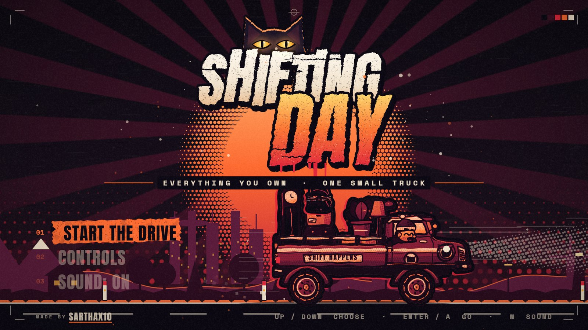</a>
</p>

<p align="center">
  
</p>

<p align="center">
  <a href="https://sarthax10.github.io/shifting-day/"><b>▶&nbsp;&nbsp;PLAY IN YOUR BROWSER</b></a>
  &nbsp;&nbsp;·&nbsp;&nbsp;desktop, gamepad or phone (held sideways)
</p>

<br>

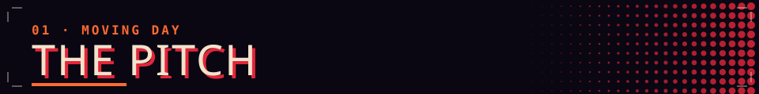

You're moving out of a falling-down house and into a manor by the sea. Everything you own goes on the back of one small truck, along with the cat, and the road between here and there has hills, toll gates, level crossings and cliffs. Every bump shifts the load.

Stack it well, tie it down, drive it gently, and catch whatever bounces off before it's gone for good.

<p align="center">
  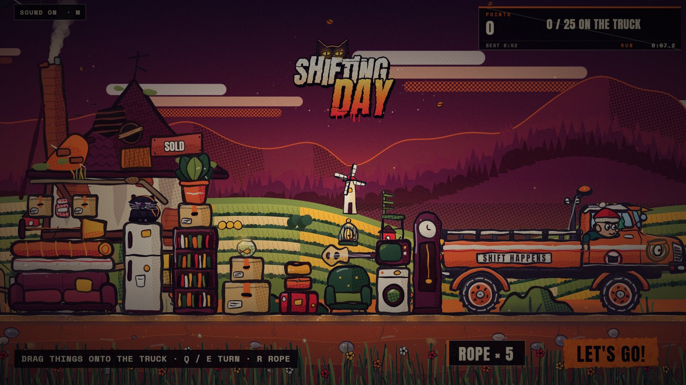
  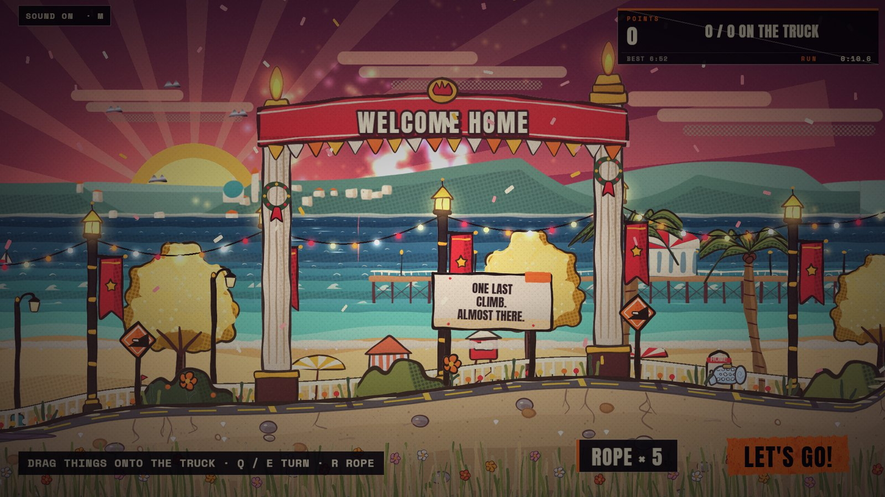
</p>
<p align="center"><sub>FROM THIS &nbsp;·&nbsp; TO THIS</sub></p>

<br>

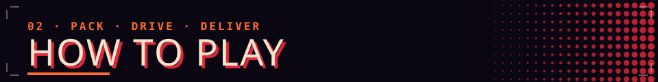

**Pack.** Drag things from the pile onto the truck. Turn them to fit, stack them, and tie the wobbly ones down with rope. Fragile things break and pets have opinions.

**Drive.** A real gearbox: let the handbrake off, pull away in first and change up when the gear light goes red. Stop at toll gates and level crossings with the handbrake on. Stall it in too high a gear and you'll have to start again in first.

**Climb and catch.** The roof-mounted anchor crossbow fires a grapple. Shoot the top of a cliff that's too steep to drive, then reel the truck up it. Shoot something that's just fallen off and it gets reeled straight back onto the bed.

**Deliver.** Park between the cones at each stop. Whatever fell off waits in the stop's Lost & Found, and you buy it back with the bubble wrap you collect on the road.

**Beat the clock.** A run clock sits under the score, and your best run is kept. At the end of the road the score card tallies what made it home.

The game teaches itself as you go: when something new comes up, a key-cap prompt appears right next to it and goes away once you've done it.

<p align="center">
  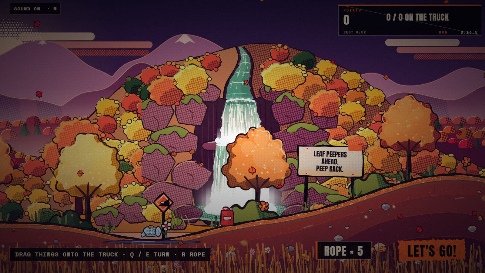
</p>

<br>

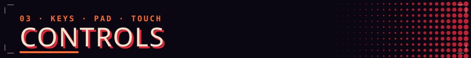

| | Keyboard + mouse | Gamepad | Touch |
|---|---|---|---|
| **Pick up and load** | `DRAG` | `DRAG` | `DRAG` |
| **Turn what you hold** | `Q` `E` `SCROLL` | `Q` `E` | twist |
| **Tie it down** | `R` | `R` | `ROPE` |
| **Gas** | `D` `RIGHT` | `RT` | `GAS` |
| **Brake** | `A` `LEFT` | `LT` | `BRAKE` |
| **Handbrake** | `P` `SPACE` | `A` | `P` |
| **Gear up / down** | `SHIFT` / `CTRL` | `RB` / `LB` | `GEAR +` / `GEAR −` |
| **First gear / reverse** | `1` / `R` | `LB` | `GEAR −` |
| **Aim the crossbow** | mouse | right stick | drag |
| **Fire the anchor** | `CLICK` | `X` | lift your finger |
| **Reel in** | `W` | `B` | `REEL` |
| **Let go** | `RIGHT-CLICK` | | |
| **Pause** | `ESC` | `START` | `PAUSE` |

The same table is in the game, under **Controls** on the title screen and in the pause menu.

<p align="center">
  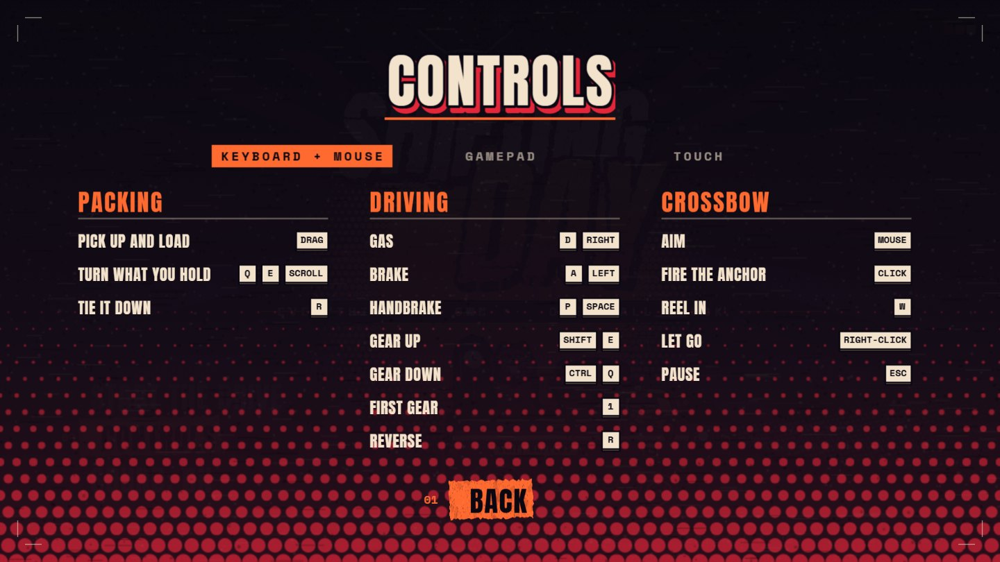
</p>

<br>

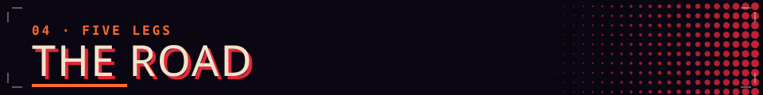

| Leg | Where | When | Stop |
|---|---|---|---|
| **1** | Old Street | the afternoon you leave | Corner Fuel |
| **2** | Maple Valley | a misty autumn morning | Maple Mill Fuel & Pie |
| **3** | Frostpeak Pass | the violet hour under a red aurora | Summit Lodge |
| **4** | Neon Town | a rainy night in the city of tomorrow | Starlite Diner |
| **5** | Coast Road | a bright morning, golden hour home | **home** |

<p align="center">
  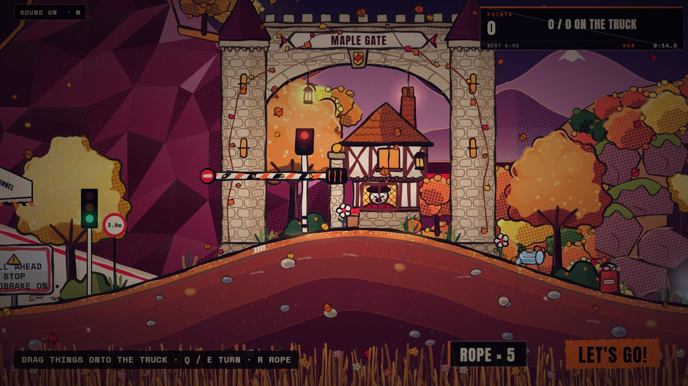
  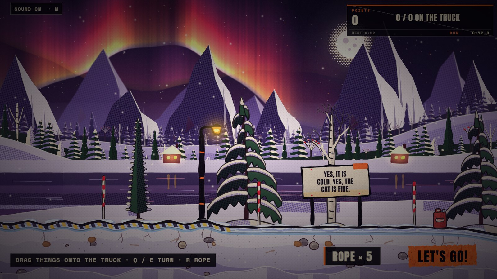
</p>
<p align="center">
  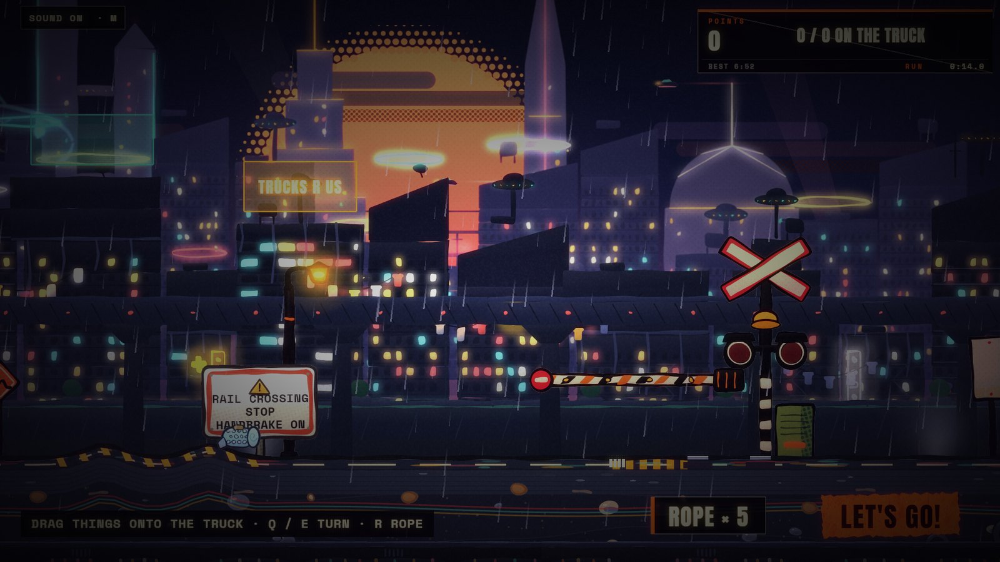
  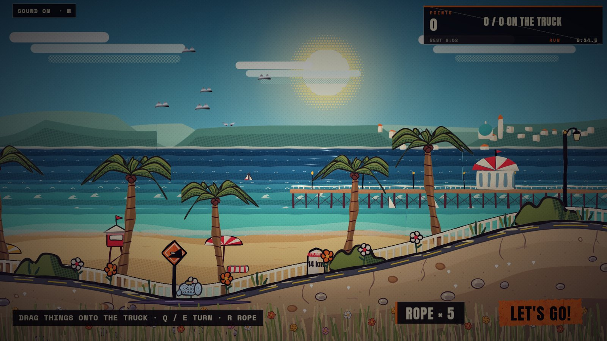
</p>
<p align="center">
  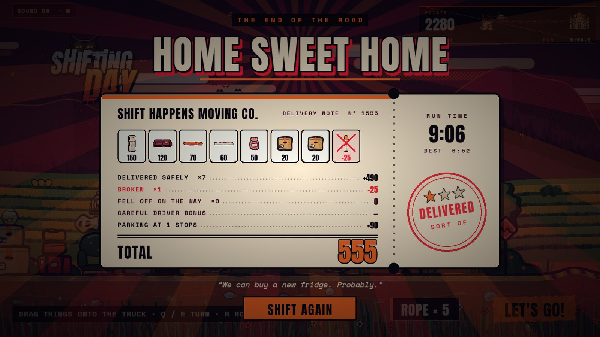
</p>

<br>

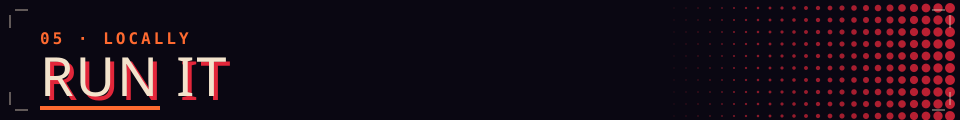

```bash
npm install
npm run dev
```

Then open http://localhost:5210. Add `?debug` to the address to see the physics shapes.

```bash
npm run build
```

builds a static copy into `dist/` with relative paths, so it runs from any folder. Every push to `master` builds and publishes it to GitHub Pages ([`.github/workflows/pages.yml`](.github/workflows/pages.yml)).

<br>


Every picture in the game is drawn in code, not painted or imported.

The source is grouped by what it does:

| Folder | What's in it |
|---|---|
| [`src/scenes/`](src/scenes) | The title screen and the game itself: packing, driving, gates, parking and the score |
| [`src/world/`](src/world) | The road and its five legs: terrain, biomes, tunnels, the finale, and the loader that draws each leg's art in the background |
| [`src/art/`](src/art) | Every picture, drawn as SVG with the wobbly ink pen in [`ink.ts`](src/art/ink.ts): the truck, the houses, trees, toll gates, skylines and the sea |
| [`src/ui/`](src/ui) | The printed poster screens (pause, Controls, Lost & Found), key-cap prompts, the dashboard and the score card |
| [`src/systems/`](src/systems) | The engine and gearbox, the anchor crossbow, sound, weather and the colour grade |
| [`src/dev/`](src/dev) | `?debug` and QA helpers |
| [`itch/`](itch) | The itch.io page: cover, banner, screenshots, description and custom CSS |

**Type:** [Anton](https://fonts.google.com/specimen/Anton) for anything you read as a word, [Space Mono](https://fonts.google.com/specimen/Space+Mono) for small labels and numbers.

**Inks:** ink, oxblood, red, ember and bone from the title screen's proof bar, with gold for highlights.

<p align="center">
  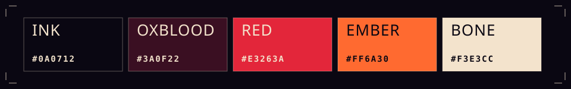
</p>

Built with [Phaser 4](https://phaser.io) and its Matter physics, TypeScript and Vite.

<br>

<p align="center">
  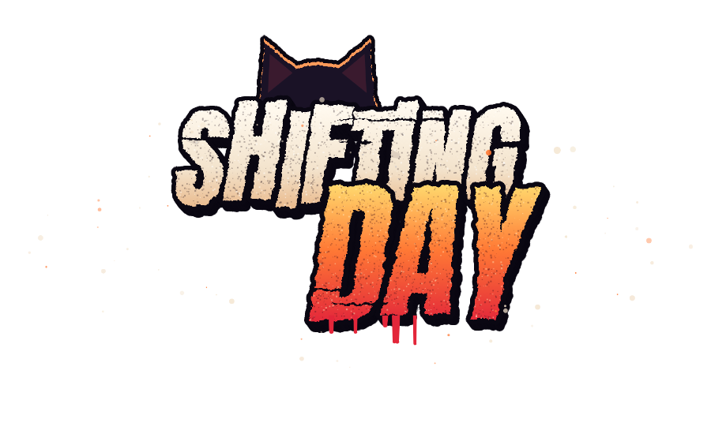
</p>

<p align="center"><sub>Made by <b>sarthax10</b>, with help from Claude (Anthropic).</sub></p>
