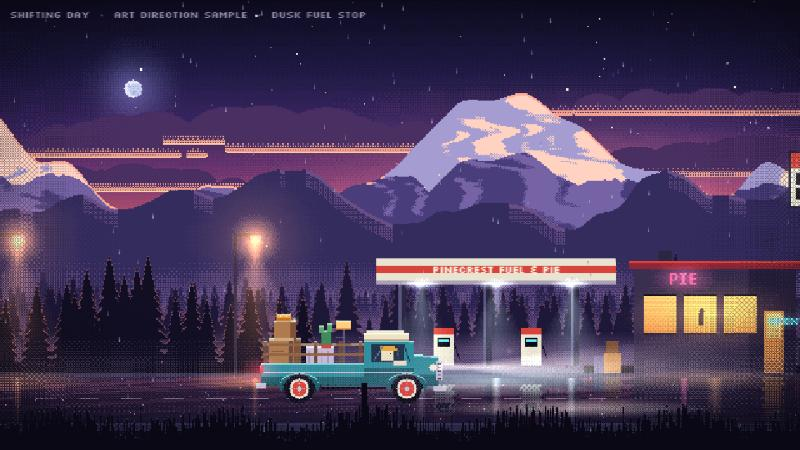
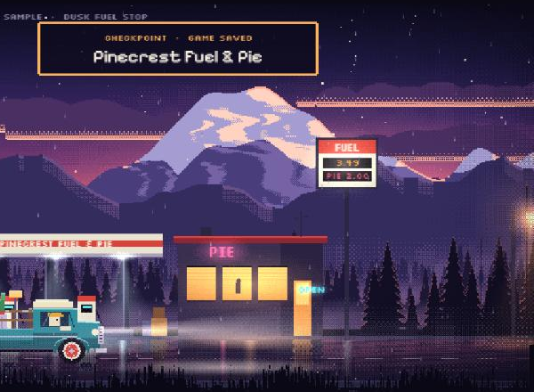

# Shifting Day: art direction and journey redesign

Status: proposal plus a working sample scene. Branch `art-direction`, worktree `D:\GithubProject\shifting-day-art`.
Run the sample with `npm run dev`, then open `/sample.html`.

## 1. What the references have in common

I studied every pin you sent. The game references (Keep Driving, August Håkansson's Statoil station, the rainy
cinema street, Shogun Showdown, the "Sandy Ruins" biome sheets, Paulo Roberto's monochrome ruins) look different
on the surface, but they all follow the same six rules. Our current game breaks most of them.

| Rule | What the references do | What Shifting Day does now |
|---|---|---|
| **One pixel grid** | Low resolution (roughly 320–640 px wide), scaled up with hard pixels, never stretched | Smooth vector ink lines at 1920 px: reads as "illustration", not "game world" |
| **Value first** | Dark ambient, a few bright light sources; you can read the scene in greyscale | Everything mid-bright and evenly lit; nothing pops |
| **Practical lights** | Lamps, neon, windows and headlights *make* the image: halos, cones, pools on the ground | Light only from a flat sky |
| **Wet reflections** | Mirrored buildings and vertical light streaks on the road | None |
| **Aerial perspective** | Each layer back is lighter, cooler, lower contrast, with mist between | Layers differ in hue only |
| **Limited palette per scene** | 12–20 colours per location, and each location has its own | One palette for everything |

The posters (Atlas, Abe's Oddysee, Night in the Woods, Namwolf, Gigantic, Pacific Drive) add one more rule:
**a single silhouette shape against one big light**, in 3–4 flat colours, with heavy display type.

## 2. Verdict on the ideas (judged, not just accepted)

- **Pixel art at 640×360 instead of vector ink: yes.** This is the biggest single change, and it is what most of
  your references share. It also fixes the old performance problem: effects that were too slow at 1920×1080 cost
  about 9× less at 640×360.
- **Dusk and night with street lights: yes, but not for the whole game.** Night is where lights and reflections
  shine, but a game that is dark all the way through is tiring. Time of day should *move* as you drive. That is
  the SHIFT theme twice over: you shift house, and the day shifts around you.
- **Gas stations: yes, and they should be the checkpoints.** A fuel stop is the perfect save point. You have to
  *park* there (parking is already a mechanic), it is a natural light source at night, and it gives a reason for
  the fuel gauge. Diners, motels and a ferry dock can play the same role.
- **One long journey with checkpoints (RV There Yet style) instead of levels: yes.** It fits a moving day and makes
  the drive memorable. Progress saves when you park at a checkpoint with the handbrake on.
- **Cyberpunk city: no.** It clashes with the tone (a cosy, funny moving day in a teal pickup), and a convincing
  neon megacity is the most expensive scene we could build. A **small-town main street at night**, with neon motel
  signs, a cinema and a diner, gives the same "wow, neon" moment, fits the story, and reuses the station lighting.
- **Caves: yes, as a mountain tunnel.** Sodium lights strobing over the truck is a cheap, gorgeous set piece.
- **Valleys: yes, as a long bridge** over a misty valley at golden hour.
- **Posters: yes.** One poster per leg, shown on the checkpoint card and on the itch.io page.

## 3. The journey: one road, five legs, one day

You leave the old house in the afternoon and arrive at the new one at sunrise. Each leg ends at a checkpoint where
you park to save. Leg lengths are about the length of today's whole level.

| Leg | Scenery and set piece | Time and light | Checkpoint (park to save) | Driving challenge |
|---|---|---|---|---|
| 1. Old Street | Suburb, packing the truck, leafy lanes | Afternoon, warm and flat | **Corner Fuel** | Learn gears, first hill, first gate |
| 2. Pine Ridge | Mountain road, forests, the high bridge over the valley | Golden hour into dusk | **Pinecrest Fuel & Pie** (the sample) | Long climbs and descents, lugging, handbrake hill starts |
| 3. The Tunnel | Through the mountain: sodium lamps, dripping water, a broken light | Night, inside | **Tunnel's End Motel** | Darkness, potholes you only see in the headlights |
| 4. Neon Main Street | Small town at night: cinema, motel signs, a drawbridge | Night, rain | **Starlite Diner** | Traffic lights and stop lines, tight parallel parking |
| 5. Coast Road | Cliffs, a lighthouse, the sea under the moon, then the new house | Pre-dawn into sunrise | **The new house** | Final parking in the driveway as the sun comes up |

Biscuit the cat reacts at every checkpoint, and each checkpoint card shows that leg's poster.

## 4. Visual pillars

1. **Light tells the story.** Every scene has one hero light (the canopy, the cinema marquee, the lighthouse)
   and a few supporting ones. Lights are additive, pixel-banded (never airbrushed), and pool on the ground.
2. **The road is a mirror.** Wet roads reflect everything above them: mirrored silhouettes, vertical streaks under
   every light, ripples that shimmer.
3. **Depth through air.** Four to six parallax layers, each lighter and cooler, with mist bands between them.
4. **Life everywhere, in small doses.** Drizzle, moths at lamps, fireflies, neon that buzzes, steam from vents,
   birds at dawn, the odd car passing. Nothing big, everything moving.
5. **Our truck, our cat.** The teal pickup and Biscuit stay the stars. Rim light on the truck from whatever lights
   the scene ties it into every location.

## 5. How we build it (tools on this machine)

- **Art in code with `src/sample/px.ts`.** A pixel canvas with ordered (Bayer) dithering, seeded noise, column and
  ellipse fills, and light textures generated at the exact size they are drawn. Landscapes, skies, mist, forests
  and lights come out of code and stay crisp. This is how the whole sample is made.
- **Rule: never scale a pixel texture.** The first pass broke this (a 64 px glow stretched to 560 px) and showed
  blocky checkerboards in the sky. Lights are now generated per size and cached.
- **Blender 5.3 (installed) for complex props** if code drawing stops scaling: model low-poly, render side-on at
  1×, quantise to the leg's palette with Python and PIL. Dead Cells built its characters this way. It is useful
  for the truck's wheels, the drawbridge and the lighthouse.
- **Krita (installed) for hand touch-ups** on hero sprites (the truck, Biscuit, posters).
- **Python with PIL and numpy (installed)** for palette quantising, sprite sheets and poster exports.
- **Fonts:** Pixelify Sans (headings) and Silkscreen (small labels), both open-source and now installed through
  npm in this branch. A custom bitmap font for the logo can come later, drawn in the same `PX` tool.
- **Rendering:** Phaser at 640×360 with `pixelArt: true` and `roundPixels`. The UI uses the same grid, which makes
  it look of a piece with the world.

## 6. Review of the sample scene

**What works, and is the direction:**
- The fuel stop at dusk reads instantly: a cold canopy light against a warm diner, PIE neon, a price sign. The wet
  road doubles every light.
- The truck at about a quarter of the screen width is big enough for the cargo physics to stay readable, and
  small enough for the scenery to breathe.
- The alpine peaks catch the last pink light, and the mist between the layers gives real depth.
- The checkpoint card ("CHECKPOINT · GAME SAVED · Pinecrest Fuel & Pie") feels like a reward.

**What still needs work before it is "breathtaking":**
- The clouds are still flat strips, not volumes. They need hand-shaped cumulus or a Blender render.
- The sky's warm band is too thin. Golden hour should own a whole leg, with the sun visible.
- The road needs more texture (cracks, puddles of different sizes) and a kerb that catches the light.
- The truck needs a second pass in Krita (proper fender curves, a chrome highlight that moves with the lights).
- Rain should splash on the bed and the cargo, not only fall past.

## 7. Risks and scope (honest)

- **Deadline: 1 December, 18 days away.** Moving the whole game to pixel art means redrawing every item, the
  truck, both houses, the UI, and rescaling the physics from 1920 to 640 units. That is about a week of work
  before any new content.
- **Recommendation:** treat the next week as a *vertical slice*: legs 2 and 5 only (Pine Ridge with the fuel-stop
  checkpoint, and the coast road arriving at sunrise), with checkpoint saving. Add legs 3 and 4 only if the slice
  is solid by about 24 November. A beautiful two-leg game beats a rough five-leg one.
- **Physics:** keep Matter's tuning by scaling all lengths by 1/3 in one place (bodies, gravity, speeds), and test
  that the gears, stalls and ropes still feel the same.

## 8. Ideas to keep for later

- **Gas stations as places, not just saves:** refuel with a hold-to-pump minigame, buy pie (heals one broken
  item's score?), a station dog who barks at Biscuit.
- **Fuel matters:** run dry between checkpoints and you coast. Gear choice affects fuel use.
- **Weather per leg:** drizzle on the ridge, heavy rain in town, sea fog on the coast.
- **Posters** for each leg: flat silhouettes, 3–4 colours, one big light, Pixelify Sans type. Example: the teal
  pickup tiny on the bridge, with a huge low sun behind it, titled "PINE RIDGE".
- **Photo mode** at each checkpoint, saving a framed postcard of the truck and its load.
